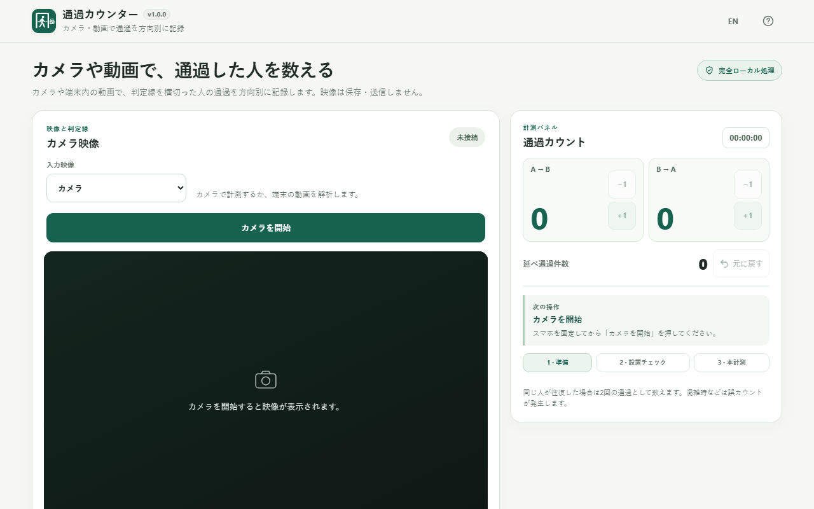
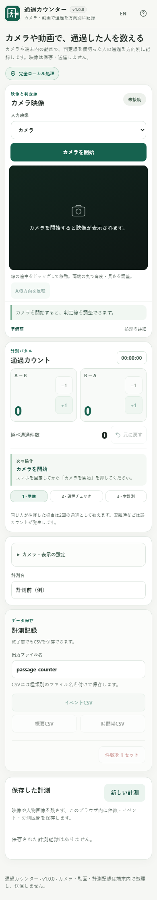

# Passage Counter / 通過カウンター

[English README](README.md)

カメラまたは端末内の動画を使い、画面上の線を人物が横切った回数を **A→B／B→A の方向別に記録する** Browser Kittyの単一HTMLツールです。インストール・アカウント登録・動画のアップロードは不要です。

**v1.0.0候補版について：** アプリのUIとバージョンはv1.0.0に更新していますが、実映像100件以上の独立精度評価、スマートフォン実機30分試験、モデル再配布条件の確認が完了していません。正式公開の品質判定は **No-Go（未承認）** です。CIの成功を実環境の精度保証として扱わないでください。[v1.0.0のリリース判定](docs/RELEASE_READINESS_v1.0.0.md)

## デモ

### [GitHub PagesでPassage Counterを開く](https://ttomohisa.github.io/htmlapps-passage-counter/)

公開済みのGitHub Pages版がある場合、その内容は開発中のPRに含まれるv1.0.0候補版と異なることがあります。v1.0.0の確認には、該当するGitHub PRのPreviewリンクを利用してください。

Webページへのアクセス時はHTMLの取得に通信が発生します。読み込み後のAI推論やカメラ・選択動画の処理は端末内で実行し、入力映像を外部へ送信しません。

画像は生成された実際のアプリ画面を撮影したもので、カメラ開始前・計測0件の状態です。[撮影方法](assets/SCREENSHOTS.md)

## 主な機能

- **方向別カウント** — A→BとB→Aの通過回数をリアルタイムに集計。人物の重複しない人数ではなく、線の横断イベントを数えます。
- **直接つかめる判定線** — 線の途中をドラッグして位置を移動。両端の白丸で長さ・角度を調整し、A/Bの方向を反転できます。
- **カメラと動画の2モード** — ライブカメラで計測するほか、端末にあるブラウザ再生可能な動画ファイルを選んで解析できます。
- **30秒の設置チェック** — カメラで計測する前に検出方向を確認。チェックの件数は本計測に加算されません。動画モードでは不要です。
- **件数をその場で補正** — 各方向のカウント枠にある−1／＋1ボタンで修正でき、直前の補正はUndoできます。修正履歴はCSVに残ります。
- **計測記録を保存** — イベント履歴、概要、5／15／60分ごとの時間帯別CSV。補正・一時停止・欠測区間も区別して記録します。
- **中断・復帰への対応** — 計測データはブラウザ内のIndexedDBへ保存。再読み込み後に記録を確認できますが、カメラを自動再起動しません。
- **単一HTML・端末内処理** — EfficientDet-Lite0（int8）、MediaPipe、SIMD版WASMを内包し、実行時の外部AI APIやCDNを必要としません。

## すぐに使う

### Webで使う

[GitHub Pages版](https://ttomohisa.github.io/htmlapps-passage-counter/)を開き、カメラまたは端末の動画を選びます。ログインは不要です。カメラを使う際には、ブラウザに権限を与える必要があります。

### HTMLファイルを保存して使う

GitHub Actionsのビルド成果物、または下記の手順で作成した **dist/index.html** を端末へ保存して開けます。アプリ本体・モデル・WASMが1ファイルに含まれるため、完成済みHTMLはネット接続なしでも利用できます。

カメラをローカルのHTMLから起動できるかはブラウザ次第です。カメラが許可されないときはHTTPS版を利用してください。スマホでの長時間・実機動作は未検証です。

### 自分でビルドする

1. リポジトリをダウンロードまたはクローンします。
2. WindowsのPowerShellで、リポジトリのルートから以下を実行します。
3. 初回ビルド時だけ固定バージョンの依存ファイルとAIモデルがダウンロードされ、SHA-256が確認されます。
4. 生成された **dist/index.html** または **dist/index.self-extract.html** を使います。

    ./scripts/check-powershell-syntax.ps1
    ./scripts/check-repository.ps1

通常版と自己展開版はどちらも単一HTMLです。**passage-counter.html** は通常版のルート配置用コピーとしてビルド時に作成されます。ビルドにはWindowsのPowerShellとtar.exeが必要です。ブラウザで完成HTMLを利用するだけならビルド環境は不要です。

## 使い方

1. **入力映像を選択する。** カメラを固定して「カメラを開始」を押すか、「端末の動画」からファイルを選びます。
2. **判定線を置く。** 線を直接ドラッグして移動し、両端の白丸で長さ・角度を調整します。A/B方向は反転可能です。
3. **設置チェックを行う（カメラのみ）。** 「30秒チェックを開始」を押し、人物の横断が想定どおり認識されるか確認します。判定線を動かした場合はチェックが無効になります。
4. **計測を開始する。** 「計測を開始」を押すと、A→BとB→Aの通過件数を記録します。動画は先頭から解析し、最後まで進むと終了します。
5. **必要に応じて補正する。** 各カウント枠の右側にある−1／＋1で修正し、直前の修正には合計件数横のUndoを利用します。
6. **停止・保存する。** 一時停止・再開・終了を操作し、イベント／概要／時間帯別CSVを保存します。

### 計測と復帰について

- カメラのプレビュー・計測中は画面を表示しておきます。非表示やカメラ停止、端末の向き変更によって計測が中断することがあります。計測できなかった時間は「0件」ではなく欠測として扱います。
- 再読み込み後は「保存した計測」から記録を開けます。映像や人物IDは保存しないため、カメラ・動画は自動で再開せず、再開には映像の選択・設置チェック等が必要です。
- 動画のプレビュー中にシークできますが、記録のある状態でシーク・再解析する際は既存結果を破棄する前に確認を表示します。動画データそのものはIndexedDBに保存しません。
- 端末／ブラウザ／サイトのオリジンを変えると保存済み記録は共有されません。必要なデータはCSVとして保存してください。

### CSVの種類

| 保存するファイル | 内容 |
| --- | --- |
| イベントCSV | 自動通過、手動補正、Undoの時刻・方向・変更量。動画の場合は動画内時刻も記録 |
| 概要CSV | 自動・手動・最終の方向別件数、計測時間、観測・一時停止・欠測時間 |
| 時間帯CSV | 5／15／60分ごとの方向別件数と有効観測時間・カバレッジ |

ファイルはUTF-8（BOM付き）で保存します。名前は「出力ファイル名」から設定できます。元の動画ファイルはCSVに含まれません。

### キーボード操作

| 操作 | 動作 |
| --- | --- |
| 判定線を選択して ←／→／↑／↓ | 線全体を少し移動 |
| Shift ＋ 矢印キー | 線全体を大きめに移動 |
| ヘルプ表示中に Esc | ヘルプを閉じ、元のスクロール位置へ戻る |

判定線は計測中・設置チェック中には移動できません。

## 開発・公開

このリポジトリはBrowser Kittyの[htmlapps-template](https://github.com/ttomohisa/htmlapps-template)系の構成を使用しています。編集対象は **src/index.template.html** で、生成済みHTMLは直接編集しません。

    src/index.template.html
    app.config.json
    dependencies.json
    dependencies.lock.json
    model.config.json
    assets/favicon.svg
    assets/screenshot.png
    assets/screenshot-en.png
    assets/screenshot-mobile.png
    assets/screenshot-mobile-en.png
    build-standalone.ps1
    scripts/check-repository.ps1
    scripts/smoke-help-v1.mjs
    dist/index.html                  # ビルド後に生成
    dist/index.self-extract.html     # ビルド後に生成

GitHub Pagesは[deploy-pages.yml](.github/workflows/deploy-pages.yml)を使い、mainブランチからビルドして公開する構成です。開発用PRのPreviewは別ワークフローで生成します。マージはユーザー本人が行います。

より詳しい仕様は [APP_SPEC.md](APP_SPEC.md)、[開発計画](DEVELOPMENT_PLAN.md)、[オフライン検証](VERIFY_OFFLINE.md)、[精度評価手順](docs/ADR-007-ACCURACY-EVALUATION.md)を参照してください。

## プライバシーと外部通信

- カメラ映像・人物画像・選択した動画ファイル・音声を、このアプリから外部サーバーへ送信しません。カメラは映像だけを要求し、音声取得は行いません。
- カメラ・動画の認識は端末内のAIモデルで処理します。必要なJavaScript、SIMD WASM、モデルはHTMLに内包しています。
- 計測名・件数・イベント・補正履歴・時間帯の記録は同じブラウザのIndexedDBに、判定線・表示設定はローカルストレージに保存します。動画は保存しません。
- CSPで外部通信先を制限し、Blob URLを内包アセットの読み出しに使用します。GitHub PagesやPreviewへの最初のHTML取得は通信を伴います。
- 外部HTTP通信0件はテストしたブラウザ経路で確認済みですが、すべてのブラウザ・ホスティング応答ヘッダーまで検証済みという意味ではありません。

## 対応環境と制限事項

- **WebAssembly SIMDと圧縮データ展開機能が必要**です。非対応のブラウザでは理由を表示して処理を停止します。
- WindowsのChrome／Edgeで内包モデルの自動テストを実施しています。実カメラ、Android Chrome、iPhone Safariの互換性・長時間性能は別途実機確認が必要です。
- 動画モードはブラウザ標準の動画デコーダを使います。選べるファイル形式と実際に再生できる形式は一致しない場合があります。
- 人物の重なり、逆光、低照度、通過速度、設置位置、カメラの動き、処理速度の低下などで通過を誤認識・見落とす可能性があります。
- カウントするのは重複しない人物数ではありません。ひとりが往復した場合は2回の通過として記録されます。
- 計測値の正確性が重要な安全管理・請求・法的報告では、独立した確認なしに利用しないでください。
- **安定版v1.0.0のリリース判定は未完了**です。100件以上の独立実映像評価・方向別95%目標・30分実機試験・モデル固有の再配布許諾が未確認です。[受入条件と未解決項目](docs/RELEASE_READINESS_v1.0.0.md)

## 使用ライブラリ・モデル

| コンポーネント | 固定バージョン／種類 | 用途 |
| --- | --- | --- |
| MediaPipe Tasks Vision | 0.10.35（Apache-2.0） | ブラウザ内の人物検出・WASMランタイム |
| EfficientDet-Lite0 | int8 TFLite、固定SHA-256 | 人物検出モデル。**このモデルファイル固有の再配布許諾は未確認** |
| アプリ固有コード | MIT | 追跡、判定線、補正、集計、CSV、保存、UI |

[第三者ライセンス・モデルの注意事項](THIRD_PARTY_NOTICES.md)

## コントリビューション

不具合報告・改善提案は[GitHub Issues](https://github.com/ttomohisa/htmlapps-passage-counter/issues)からお願いします。[CONTRIBUTING.md](CONTRIBUTING.md)にも開発方針を記載しています。

## ライセンス

Copyright © 2026 ttomohisa

アプリ本体は [MIT License](LICENSE) です。第三者コンポーネントのライセンスは別途確認してください。
