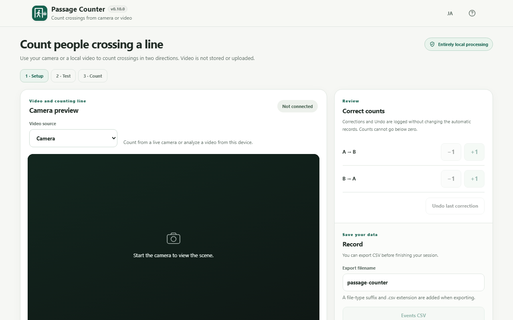
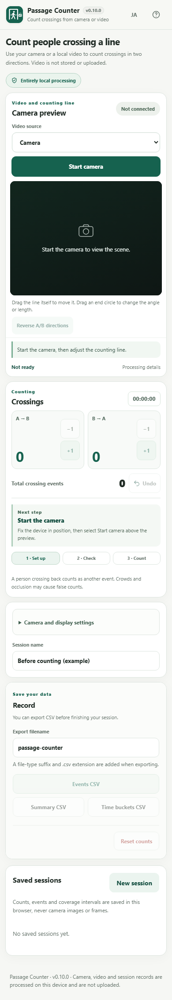

# Passage Counter

Count **person-crossing events by direction** using a fixed camera or a local video and one draggable counting line. The complete application—including its AI model, JavaScript loader and **SIMD-only WASM**—lives inside one HTML file.

**This branch is a SIMD-only v0.10.0 interaction/UX preview, not the production default.** Browsers without WebAssembly SIMD cannot start the camera; the limitation is shown before camera permission. Person tracking and crossing decisions still require real-world evaluation and **not yet accuracy-validated**. Do not rely on these counts for safety, legal reporting or billing without independent checks.

## v0.10.0 — A/B line movement and camera-first layout

The counting line can now be **dragged anywhere along its middle** to reposition both endpoints together, preserving its angle and length. Drag a white endpoint when you want to rotate or resize the line. The line itself is the drag target; no extra centre handle is displayed. The line is locked during counting or the setup test, and moving it after calibration requires another test.

The interface is reorganized around the work: **select camera/video → adjust line → run camera setup test → start counting → review or correct → export CSV**. Directional counters and elapsed time appear **beside the camera on desktop and immediately below it on phones**, not at the bottom after settings. The camera button is above the preview; when ready, a clearly labeled 30-second setup check appears with instructions and its own button. Completing the check reveals the real Start counting button. **Manual +1/−1 and Undo now sit directly beneath the live counts in the same card**, so corrections are easy to reach while watching totals; the CSV exports remain in a separate Save section. Only the next relevant action is emphasized. Corrections, Undo, and exports remain separate. On phones, touching empty video space does not block vertical scrolling; the draggable line and endpoints have independent touch targets. The interface retains the Browser Kitty header, official SVG favicon, #16624f and Japanese/English support.

The new [ADR-008](docs/ADR-008-LINE-DRAG-AND-UX.md) documents gesture constraints, stage letterboxing, touch/keyboard behavior and regression gates. This is still a preview: **physical-device endurance, genuine real-world accuracy and model-specific redistribution rights remain unverified**.

## Screenshots — current v0.10.0 interface

These images are genuine browser captures from the built Passage Counter app, showing **the setup screen before any camera or counting**. No faces, fabricated detection counts or personal data were used.





Japanese screenshots: [desktop](assets/screenshot.png) · [mobile](assets/screenshot-mobile.png). [Capture method and provenance](assets/SCREENSHOTS.md).

## v0.9.0 — release review (not yet approved)

This draft completes the release documentation and asset pipeline: pinned SVG favicon, bilingual live-UI screenshots, standalone and CSV integrity checks, CI regressions, actual dependencies and hashes, and explicit evidence-based release gates. **It is not the production release candidate until the remaining hard gates are closed.**

**Outstanding blockers:** independently labeled 100+ real crossings and the ≥95% per-direction precision/recall target; 30-minute real Android/iPhone fixed-camera tests and heat/memory/fps; definitive redistribution permission for the precise EfficientDet model file and license delivery review; actual deployed response CSP. See [v0.9 release readiness](docs/RELEASE_READINESS_v0.10.0.md) and [third-party notices](THIRD_PARTY_NOTICES.md).

## Browser Kitty interface and usability

The v0.6.0 header and hero follow the same visible conventions as [PDF Fill & Sign](https://browser-kitty.com/apps/pdf-fill-sign.html) and [Wi-Fi Share](https://browser-kitty.com/apps/wifi-share.html): a compact sticky light header, matching favicon/icon, localized app name with version, EN/JA button, SVG help icon, concise title and **Entirely local processing** badge. The badge describes the processing of camera/video/user data; visiting a hosted page still downloads that HTML. The standalone HTML uses no runtime external CDNs, analytics or telemetry. Browser automation checks Japanese/English, 320/360/390/820/1280px viewports, horizontal overflow, help label and favicon/brand identity. The CI artifacts include Japanese/English mobile/desktop screenshots.

## v0.7.0 cross-browser integration and evidence

v0.7.0 adds an evidence-scoped desktop Windows Chrome/Edge CI target: real embedded-model inference using a simulated camera, adjustment/CSV export, blocked outbound HTTP, combined meta+header CSP checks, cold-cache offline single-HTML startup, and bilingual error/dialog regression. Camera permission and rejected-video error messages now stay translated when switching between EN and JA; video-preview and aggregation accessibility labels are localized.

**Not yet verified:** real Android Chrome, iOS Safari, 30-minute mobile heat/battery/memory/fps, live counting accuracy, and the actual Cloudflare response CSP header. Desktop simulated-camera and file tests are not a claim of physical-device compatibility. See the [v0.7.0 compatibility matrix and physical-device checklist](docs/ADR-006-INTEGRATION-AND-COMPATIBILITY.md).

## v0.8.0 — accuracy evaluation and header consistency

- Replaced the app header icon and generated favicon with the **provided Passage Counter SVG** (64×64, #16624f, rx=16). Both use exactly the same embedded SVG in the readable and self-extract HTML editions.
- Changed the header Help action to the **Wi-Fi Share-style unboxed 20px SVG** with a transparent 44×44 touch target and retained focus, help dialog and EN/JA labels.
- Added the **fully local reviewer helper** [label-passages.html](evaluation/label-passages.html). Open a local video, position its line, label A→B or B→A passage times, undo mistakes and download human ground-truth CSV. It never uploads or persists the video.
- Added the offline [accuracy evaluator](scripts/evaluate-accuracy.mjs). It compares app **automatic events only** (not manual corrections/Undo) against independently labeled events, using direction-specific one-to-one matching within ±1.5 seconds. It reports TP/FP/FN, Precision/Recall overall and by direction, calibration vs holdout and standard vs difficult scenes.
- Added deterministic matching/error tests and a **synthetic-only** three-event example. Synthetic data cannot satisfy the release-accuracy gate.

**No physical-data accuracy has been measured in this PR.** The required 100+ independently labeled *real* fixed-camera crossings, both directions, and the 95% target are still **open**. Android Chrome/iPhone Safari/30-minute endurance are also unverified. See [ADR-007 accuracy protocol](docs/ADR-007-ACCURACY-EVALUATION.md) and [ADR-006 compatibility matrix](docs/ADR-006-INTEGRATION-AND-COMPATIBILITY.md).

To check the evaluation tools without real footage:

```sh
node scripts/test-accuracy-evaluator.mjs
node scripts/evaluate-accuracy.mjs examples/accuracy/synthetic-manifest.json --json=dist/accuracy-example.json --md=dist/accuracy-example.md
```

## Features

- **Two input modes:** live camera (permission requested on Start camera) or local video (file picker and drag/drop).
- **Local video analysis** with browser-native video decoding, file preview/seek, counting from clip start, media-time event timestamps, and explicit confirmation before seeking/reanalysis invalidates results.
- Video file bytes remain on the device only, use Blob-backed streaming playback, are never stored with the session, and are released on close/page exit. Browser format support varies.
- Live camera preview; permission is requested only after choosing **Start camera**.
- EfficientDet-Lite0 int8 person detection with MediaPipe Tasks Vision.
- Draggable line endpoints, reversible A/B direction, short-term prediction/IoU tracking, stable-side hysteresis, finite-line crossing, and directional counts.
- **30-second setup test** with isolated trial counts. The test can be stopped early and never contributes to the measured session.
- **A→B/B→A manual +1/-1**, zero-floor safety and single-step Undo. Automatic, correction and Undo events stay separate in the CSV.
- Custom direction labels, front/rear camera selection, person-box overlay toggle and locally remembered settings.
- **IndexedDB saved sessions** with event-by-event atomic writes, periodic checkpoints, a saved-session list, deletion confirmation, and interrupted-session recovery without automatic camera restart.
- Observed/paused/missing time intervals (missing counts are not treated as zero), selectable 5/15/60-minute grouping, with local-time bucket summaries.
- Three UTF-8 BOM CSV exports: session summary, all events and time buckets, with preserved adjustment/Undo audit trails.
- On storage failure: visible warning and in-memory CSV rescue, without claiming records were saved.
- Start, pause, resume, finish and elapsed-time display.
- **Performance-aware counting:** latest-frame inference without a queue, measured frame-rate/latency diagnostics in a collapsed panel, adaptive 105–225 ms scheduling, and accessible **Recognizing / Processing is slow** statuses.
- **Safer interruptions:** extremely slow sustained processing stops counting rather than guessing missed crossings; background tabs and orientation changes interrupt without auto-resume; Screen Wake Lock late/release events are handled.
- Event writes keep transactional IndexedDB durability; the 5-second checkpoint timer no longer forces a full page re-render, and the time-bucket UI is throttled independently. Decoded model/WASM byte caches and temporary loader URLs are released after initialization.
- English / Japanese, mobile-first responsive interface and attempted screen wake lock.
- No account, runtime CDN, remote inference, telemetry, upload or recording.

## Usage

1. Open a standalone HTML under HTTPS or locally in a browser that permits camera use for \`file://\`.
2. Fix the camera in place and include the entire passage in the frame.
3. Choose **Start camera** above the preview, grant permission, and drag the line itself to move it or its endpoints to resize/rotate.
4. Reverse the direction if necessary. Press **Start 30-second test** and walk across the line. You may stop the test early. Trial counts are excluded from the real session.
5. Press **Start counting**. Keep the page visible. Use **+1/-1** for either direction to correct misses or false counts, and **Undo** if the last correction was wrong.
6. Pause/resume if needed; missing coverage is distinguished from zero crossings. Finish and export **events / summary / time buckets** as CSV. You can rename the output file.
7. Open saved sessions from the **Saved sessions** section after reloading. An interrupted session opens stopped; reconnect the camera, re-run the placement test, and manually start counting to resume.

A person passing back across the line counts as another event. The number is **not a unique visitor count**. Crowding, occlusion, unusual viewpoints, glare, low light or camera motion can cause errors.

## Local video analysis (v0.5.0)

Choose **Local video** under **Video source**, then choose or drag and drop a file (such as browser-decodable MP4 or WebM). The file is opened through a temporary local Blob URL; there is **no upload, file conversion or large whole-file read**. Pause/preview/seek to check the counting line before counting. Preview playback does not add counts, and **Start counting** rewinds to the beginning. The 30-second calibration test applies only to camera mode.

While analyzing, **Pause**, **Resume**, **Finish**, directional correction/Undo and all three CSV exports remain available. At the end of the video, counting finishes without looping. A seek or **Reanalyze from start** with recorded counts requires explicit confirmation and clears those counts, correction history and saved session before starting over. Browser-initiated seeks during active counting stop the session to prevent duplicate counts.

The event CSV includes numeric **`source_time_ms`** for the original video position, including manual corrections; camera events use an empty value. CSV summary uses **`source_type=file`** for prerecorded videos. Time buckets are by **wall-clock time when the analysis ran**, not the media timeline. Use `source_time_ms` when you need positions within the video. Video content, file name and Blob URL are **not persisted**; after refreshing you can inspect saved counts/CSV but must select the video again for a new analysis.

Browser-supported video formats vary by OS/browser and codec. MP4/H.264 and WebM/VP8/VP9 are common, but not universal; some browsers support MOV/HEVC while others do not. The app uses built-in decoders, not FFmpeg, and reports unsupported/corrupt inputs without uploading them. For WebM files lacking finite duration metadata, a browser-based duration probe is attempted; if still unknown, playback/counting can work while seeking remains unavailable.

## Privacy and data

The camera requests video only, with audio disabled. Frames and short-term tracking data remain in browser memory. No video, still images, faces or sound are saved or transmitted. In v0.5.0, camera facing, line position, custom labels, and overlay preferences use localStorage. **Sessions, direction counts, appended correction/Undo events, and observed/paused/missing coverage intervals are saved in IndexedDB** on the same browser origin. Images, audio, video, persistent person IDs, and camera device identifiers are not saved. An event and its session snapshot are committed in one transaction; a five-second checkpoint reduces crash-loss exposure. Browser storage can still be cleared, denied, or exhausted, so no uncommitted event is guaranteed to survive a crash. If storage fails, a visible warning tells you to export CSV before leaving.

The runtime's CSP uses \`connect-src blob:\` so the WebAssembly loader can read *embedded in-memory* bytes through Blob URLs. No remote HTTP(S) origin is allowed. Consult local camera notice and privacy requirements before deploying in public or workplace locations.

## Offline session recovery

When the tab is hidden or camera is lost, the current observed interval ends and the session becomes interrupted. After a hard crash, the last saved checkpoint is treated as the end of confirmed observation; elapsed time beyond it becomes an explicit **missing** interval. Loading the saved session never automatically resumes a camera, video or count. Video source bytes are deliberately not saved; a restored file session can be reviewed/exported but cannot resume playback without selecting the source again. A fresh placement test is required. Pauses are tracked separately. Saved sessions are per browser and origin: a downloaded `file://` HTML and a hosted `https://` copy do **not** share their IndexedDB records automatically. Concurrent editing of the same session in multiple tabs has not been validated; use one tab per active counter.

## CSV event format

CSV fields: `event_id`, `occurred_at` (UTC ISO timestamp), `direction`, `direction_label`, `kind` (`auto`, `correction`, `undo`), `delta`, `elapsed_ms`, and `undo_of` (a correction event ID for Undo). Trial test events are **never exported**. Local-video events include an actual numeric `source_time_ms`; the analysis clock remains the source of the existing 5/15/60-minute wall-time summaries. Additional event columns: `session_id`, `source_time_ms`, `event_kind_v1` (`auto`/`manual_adjustment`/`undo_adjustment`) and `reference_event_id`. The **summary** CSV includes observed/paused/missing milliseconds and automatic/manual/final counts by direction. The **interval** CSV includes the chosen bucket size, direction counts, valid seconds and coverage status. ISO timestamps are UTC; exports include a time-zone identifier. The event list preserves corrections without modifying the auto-count history. Counts represent **crossings**, not unique people.

## SIMD-only size experiment

Using the same EfficientDet model and complete counting UI, the generated HTML measured **13,505,896 B** (dual WASM) vs **9,150,133 B** (SIMD only), a **4,355,763 B / 32.25%** reduction on one CI runner. This does **not** imply faster inference: SIMD-capable browsers already selected SIMD in the old build. See [ADR-002](docs/ADR-002-SIMD-ONLY.md).

## Performance, memory and release limitations

The detector is CPU/WebAssembly SIMD and still runs **synchronously on the main browser thread**; no Web Worker/OffscreenCanvas path is claimed. Before moving the model to a Worker, it would be necessary to verify that the current MediaPipe runtime, video frame transfers, one-file Blob loading and mobile browsers actually support that architecture without delaying frames. For this milestone, the tested reliable fallback is the existing main-thread detector with latest-frame selection and dynamic pacing. An inference that takes longer than the interval runs again only after it completes; the tool does not queue old frames. It may still miss crossings on slower phones.

A Windows Chrome **20-second synthetic camera** check measured approximately **8.6 detection fps**, mean inference time **87ms**, and JavaScript heap used around **5.3–5.5 MB** at the two snapshots. These are CI host diagnostics, **not mobile benchmarks, peak process memory, person accuracy tests or a 30-minute endurance pass**. The target of 8 fps on a representative midrange phone and a 30-minute physical-device run remain unverified. If sustained fps becomes very low (~below 2.8 or inference >390ms for 8 seconds), the app interrupts rather than presenting missing time as measured zero.

## Browser support

**WebAssembly SIMD is required.** Unsupported browsers are blocked before requesting camera permission, with a bilingual message. Desktop/Android Chrome and Edge are primary testing targets; Safari and Firefox need additional real-device verification. A browser must support camera permissions, WebAssembly, and gzip \`DecompressionStream\`. Hidden tabs and locked screens cannot be counted reliably.

## Fully bundled builds

The project follows [htmlapps-template](https://github.com/ttomohisa/htmlapps-template). Do not edit generated files; work in \`src/index.template.html\`.

\`\`\`powershell
.\scripts\check-powershell-syntax.ps1
.\scripts\check-repository.ps1
\`\`\`

The builder downloads exact dependencies **at build time only**, verifies the npm tarball SHA-256 and model SHA-256, embeds every required byte and creates:
- \`dist/index.html\`
- \`dist/index.self-extract.html\`
- \`passage-counter.html\` (byte-for-byte copy of readable HTML)

Generated manifests and a size report are in \`dist/\`. The CI browser smoke test uses a synthetic camera and verifies the AI initializes from the HTML and makes no external HTTP requests. A synthetic-camera test **does not establish counting accuracy**.

See [APP_SPEC.md](APP_SPEC.md), [DEVELOPMENT_PLAN.md](DEVELOPMENT_PLAN.md), [VERIFY_OFFLINE.md](VERIFY_OFFLINE.md), [local persistence ADR](docs/ADR-003-LOCAL-PERSISTENCE.md), [local video ADR](docs/ADR-004-LOCAL-VIDEO.md) and [UI/performance ADR](docs/ADR-005-PERFORMANCE-AND-UI.md).

Build size and optimization measurements: [docs/SIZE_BUDGET.md](docs/SIZE_BUDGET.md).

## License

Application: MIT; dependencies and AI model: see [THIRD_PARTY_NOTICES.md](THIRD_PARTY_NOTICES.md).
